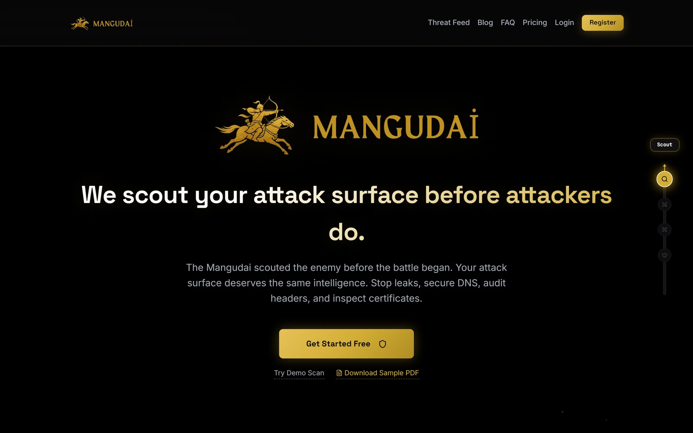
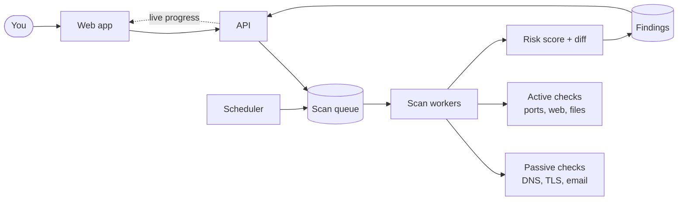

# Mangudai

**External attack surface management for small security teams, agencies and MSSPs.**
Enter a domain. See what an attacker sees from the outside. Get fix steps, not noise.

[**Run a free scan**](https://mangudai.io) · [Sample PDF report](https://mangudai.io/mangudai_sample_report_en.pdf) · [Pricing](https://mangudai.io/#pricing) · [Blog](https://mangudai.io/blog) · [Threat feed](https://mangudai.io/news)

---

## What it does

Mangudai scans a domain from the outside and reports what is exposed: forgotten subdomains, open ports, weak TLS, missing security headers, leaked files and email spoofing gaps. Nothing to install, no agent to deploy. Most scans finish in one to three minutes and stream live to the dashboard.

Example report card. The domain shown is a demo target.

## The nine scan modules

| # | Module | What it checks |
|---|---|---|
| 1 | Forgotten asset discovery | Old, staging and forgotten subdomains |
| 2 | Open port and service audit | Exposed databases and remote access ports |
| 3 | Web availability probing | HTTP/HTTPS reachability without false positives |
| 4 | Security header audit | HSTS, CSP, X-Frame-Options, Referrer-Policy, Permissions-Policy |
| 5 | Critical file and data leak guard | Exposed `.git`, backups, env files, directory listings |
| 6 | SSL/TLS certificate inspector | Expiry, self-signed, hostname mismatch, weak protocols |
| 7 | Email security | SPF and DMARC records and policies |
| 8 | Nikto web scan | Common web misconfigurations |
| 9 | SQL injection heuristics | Safe canary checks on query parameters |

Known vulnerabilities are matched against the NVD. Matches that come only from a software banner are shown as **unverified**, because distributions often patch without changing the version. Modules 8 and 9 are active checks: they run only for registered accounts that sign an authorization declaration for that scan, and never on anonymous demo scans.

## Built for

- **Small security teams** that need an outside view without an enterprise contract.
- **Agencies and MSSPs** that report to clients: white-label PDF reports and a client portfolio view.
- **Founders** who want to know what is visible before a customer or auditor asks.

Reports include a technical KVKK and GDPR pre-assessment. It is a technical check, not legal advice or a certification.

## Plans

| Plan | Price | Scans / month | Scope | Highlights |
|---|---|---|---|---|
| **Scout** | Free | 5 | 1 project, 1 target | Subdomains, SSL/TLS, headers, SPF/DMARC |
| **Warrior** | $29 / mo | 20 | 5 projects, 20 targets | Port, web and file scans, basic PDF export, weekly monitoring (3 targets), email alerts |
| **Commander** | $59 / mo | 60 | Unlimited | AI executive summary, PDF in 6 languages, dark web check, daily monitoring (10 targets), API access, Slack alerts |
| **Khan** | $149 / mo | 300 | Unlimited | White-label PDF, client portfolio, daily monitoring (50 targets), priority support |

Current prices are always on [mangudai.io](https://mangudai.io/#pricing).

## How it works

Scans run as background jobs, so a slow target never blocks the dashboard. A scheduler re-scans monitored targets and alerts you when something changes.

## About this repository

This is the public overview of Mangudai. The product source code is private. Questions, bug reports and feedback: [support@mangudai.io](mailto:support@mangudai.io). Security reports: see [SECURITY.md](SECURITY.md).

Built by [Oktay Bilge](https://www.linkedin.com/in/oktaybilge/) · [Mangudai on LinkedIn](https://www.linkedin.com/company/135156659/)

The Mangudai were Mongol cavalry archers who rode ahead of the army to probe the enemy before the battle. The product does the same for your domain.
