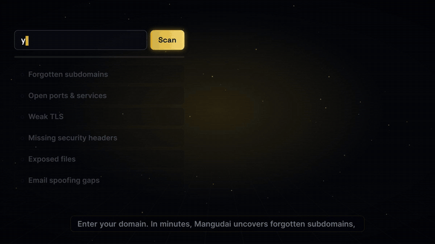
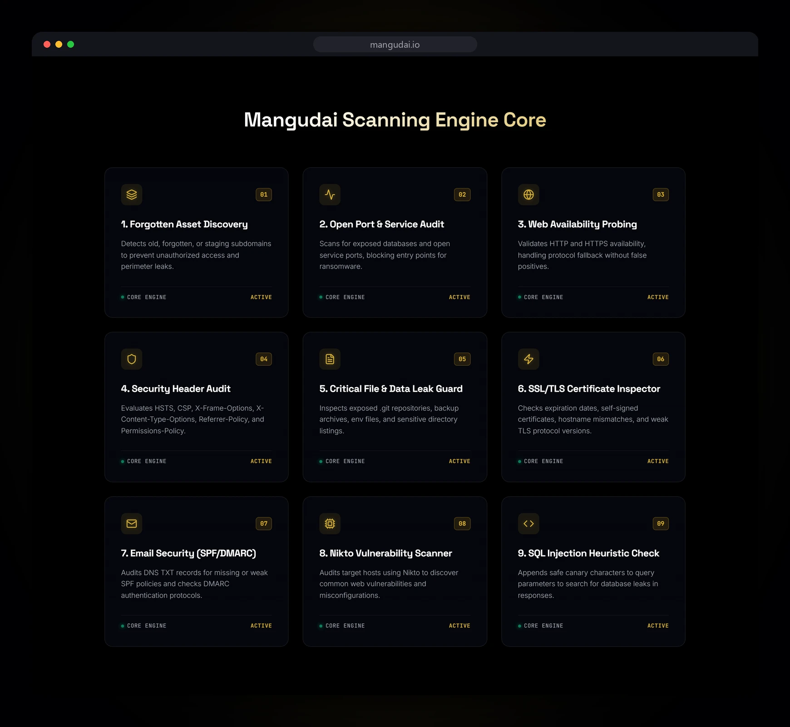
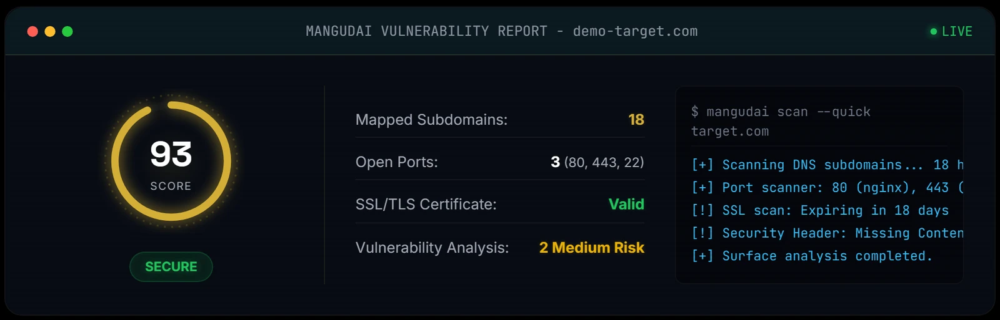
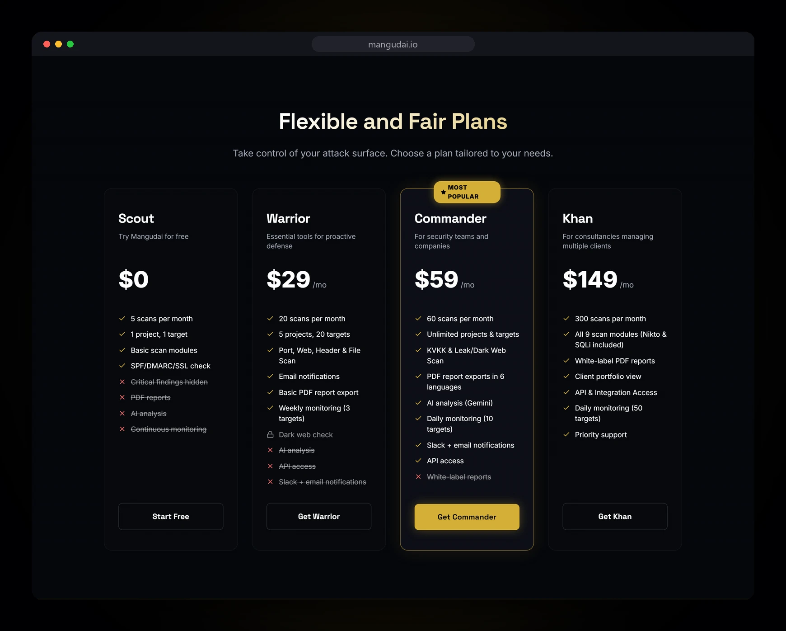
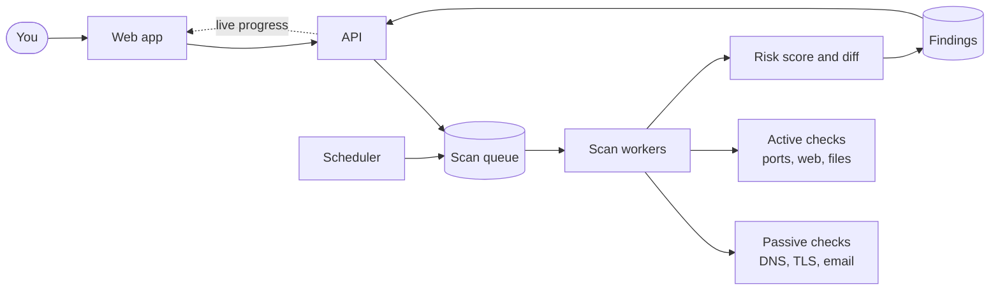

 

**[Run a free scan](https://mangudai.io)** &nbsp;·&nbsp; [Sample PDF report](https://mangudai.io/mangudai_sample_report_en.pdf) &nbsp;·&nbsp; [Pricing](https://mangudai.io/#pricing) &nbsp;·&nbsp; [Blog](https://mangudai.io/blog) &nbsp;·&nbsp; [Threat feed](https://mangudai.io/news)

---

## See it in 20 seconds

Enter a domain. Mangudai looks at it from the outside, the way an attacker would, and returns a ranked list of what it found with fix steps. Nothing to install and no agent to deploy. Most scans finish in one to three minutes and stream live to the dashboard.

Illustrative output for `example.com`. Real scans show real hosts, ports and findings.

## Why teams use it

| | |
|---|---|
| **An attacker's view, not an inventory** | Subdomains, open ports, weak TLS, missing headers, exposed files and email spoofing gaps, ranked by severity with plain-language fix steps. |
| **Honest findings** | Version matches from a software banner are marked **unverified**, because distributions often patch without changing the version. Fewer false alarms means findings get read. |
| **Reports clients can use** | PDF export in six languages with an AI executive summary. White-label reports and a client portfolio view for agencies and MSSPs. |
| **Always watching** | Scheduled re-scans, drift detection and alerts by email or Slack when something new appears. |
| **Safe by design** | Rate-limited requests. Exploitation is never attempted. Active checks run only after you sign an authorization declaration for that scan, and never on anonymous demo scans. |
| **Set up in seconds** | No agents, no installation, no sales call. Start free and upgrade when you need more. |

## The nine scan modules

| # | Module | What it checks |
|---|---|---|
| 1 | Forgotten asset discovery | Old, staging and forgotten subdomains |
| 2 | Open port and service audit | Exposed databases and remote access ports |
| 3 | Web availability probing | HTTP/HTTPS reachability without false positives |
| 4 | Security header audit | HSTS, CSP, X-Frame-Options, X-Content-Type-Options, Referrer-Policy, Permissions-Policy |
| 5 | Critical file and data leak guard | Exposed `.git`, backups, env files, directory listings |
| 6 | SSL/TLS certificate inspector | Expiry, self-signed, hostname mismatch, weak protocols |
| 7 | Email security | SPF and DMARC records and policies |
| 8 | Nikto web scan | Common web misconfigurations |
| 9 | SQL injection heuristics | Safe canary checks on query parameters |

Known vulnerabilities are matched against the NVD. Modules 8 and 9 are the active checks described above.

## What a report looks like

Example report card for a demo target. Download a full [sample PDF report](https://mangudai.io/mangudai_sample_report_en.pdf).

## Plans

| Plan | Price | Scans / month | Scope | Highlights |
|---|---|---|---|---|
| **Scout** | Free | 5 | 1 project, 1 target | Subdomains, SSL/TLS, headers, SPF/DMARC |
| **Warrior** | $29 / mo | 20 | 5 projects, 20 targets | Port, web and file scans, basic PDF export, weekly monitoring (3 targets), email alerts |
| **Commander** | $59 / mo | 60 | Unlimited | AI executive summary, PDF in 6 languages, dark web check, daily monitoring (10 targets), API access, Slack alerts |
| **Khan** | $149 / mo | 300 | Unlimited | White-label PDF, client portfolio, daily monitoring (50 targets), priority support |

Current prices are always on [mangudai.io](https://mangudai.io/#pricing).

## Built for

- **Small security teams** that need an outside view without an enterprise contract.
- **Agencies and MSSPs** that report to clients every month.
- **Founders and IT leads** who want to know what is visible before a customer or an auditor asks.

Reports include a technical KVKK and GDPR pre-assessment. It supports readiness work; it is not legal advice or a certification.

## How it works

Scans run as background jobs, so a slow target never blocks the dashboard. A scheduler re-scans monitored targets and alerts you when something changes.

## FAQ

<b>Will a scan slow down or damage my site?</b>

 
Scans are low-impact: requests are rate-limited, exploitation is never attempted and forms are not submitted.

<b>Do I need to prove I own the domain?</b>

 
Passive checks (DNS, TLS, headers, email security) can run on any domain you are authorized to assess. Active checks (Nikto and SQL injection heuristics) run only for registered accounts that sign an authorization declaration for that scan.

<b>What does the free Scout plan include?</b>

 
One domain, up to five scans a month: subdomain discovery, SSL/TLS, security headers and SPF/DMARC checks. Remediation steps for critical and high findings are on paid plans.

<b>Does it replace a penetration test?</b>

 
No. It shows what is visible and known from the outside, continuously and cheaply. A penetration test goes deeper into how your application behaves.

<b>How long does a scan take?</b>

 
Most scans finish in one to three minutes. Progress and findings stream live to your dashboard.

## About this repository

This is the public overview of Mangudai. The product source code is private. Questions, bug reports and feedback: [support@mangudai.io](mailto:support@mangudai.io). Security reports: see [SECURITY.md](SECURITY.md).

Built by [Oktay Bilge](https://www.linkedin.com/in/oktaybilge/) · [Mangudai on LinkedIn](https://www.linkedin.com/company/135156659/) · [mangudai.io](https://mangudai.io)

The Mangudai were Mongol cavalry archers who rode ahead of the army to probe the enemy before the battle. The product does the same for your domain.

