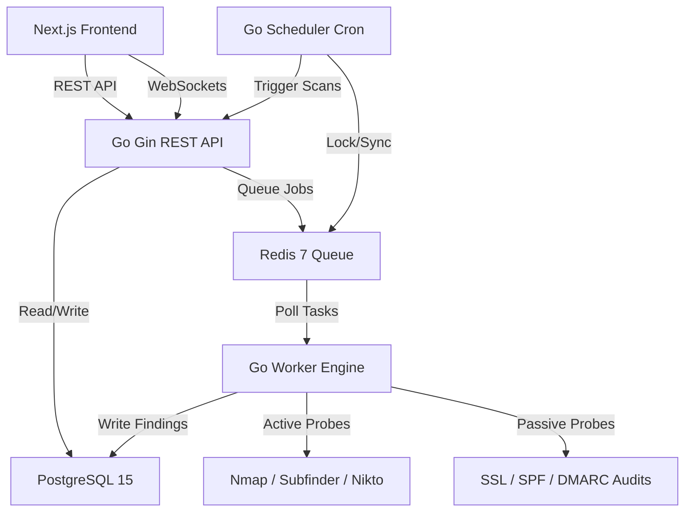

# 🛡️ Mangudai Attack Surface Management (ASM) Platform

**Mangudai ASM** is a comprehensive, multi-tenant External Attack Surface Management (EASM) and Vulnerability Management SaaS platform. It continuously discovers, audits, and monitors external-facing digital assets (subdomains, open ports, web applications, SSL certificates, email records) to assess organization-level risk scores and identify critical vulnerabilities.

> [!NOTE]
> This repository is a **Public Documentation & Showcase Hub** for the Mangudai ASM platform. The core commercial source code (Go microservices & Next.js frontend) remains proprietary and private. For inquiries or live access, visit [mangudai.io](https://mangudai.io).

---

## 📐 System Architecture

Mangudai ASM is built as a highly scalable microservice system utilizing a decoupled REST API and an asynchronous background worker queue.

### Components Summary:
1. **Frontend:** React / Next.js (App Router) styled with high-fidelity Vanilla CSS, using `framer-motion` for fluid dashboard animations and `lucide-react` for responsive iconography.
2. **Backend API:** Go (`Gin Gonic`) server handling multi-tenant authorization, project/target configuration management, JWT authentication, stripe billing integration, and WebSocket-based live progress synchronization.
3. **Scan Worker Engine:** A Go daemon polling Redis task channels to execute high-performance concurrent security scans, coordinating CLI binary wrappers (`nmap`, `subfinder`, `nikto`) and native network probes.
4. **Scheduler Service:** A Go container managing recurring automated checks for domain configurations (SSL expiry, DNS drift, and leaked credentials).
5. **Data Layer:** PostgreSQL 15 stores team/user accounts, targets, scan historical logs, and vulnerabilities. Redis 7 handles distributed worker locks, task queues, and API rate-limiting tokens.

---

## 🛠️ The 9 Scan Engine Modules

Mangudai ASM features an orchestrator (`worker.go`) that spawns concurrent analysis threads in a goroutine pool. Based on the tenant's plan quotas, the following 9 modules execute:

1. **Subdomain Discovery (Module 1 - Passive)**
   * Maps the external DNS attack surface using integrations like `subfinder` to discover active subdomains and target hosts.
2. **Port Scanning & Service Fingerprinting (Module 2 - Active)**
   * Leverages custom `nmap` TCP parameters to find open ports and identify active system services.
3. **Web Probing (Module 3 - Active)**
   * Probes HTTP/HTTPS ports to analyze web technologies, server types, and framework versions.
4. **Security HTTP Header Audit (Module 4 - Active)**
   * Evaluates HTTP security headers (CSP, HSTS, X-Frame-Options, Permissions-Policy) to identify missing protective controls.
5. **Sensitive File & Directory Leakage Scanner (Module 5 - Active)**
   * Scans for exposed project structures, environment configurations (`.env`, `.git`), code backups, and database dumps.
6. **SSL/TLS Certificate Inspection (Module 6 - Passive)**
   * Audits SSL/TLS cipher strength, expiry dates, and issuer validation records to avoid domain downtime or man-in-the-middle risks.
7. **Email Security Auditing (Module 7 - Passive)**
   * Audits DNS-level email validation configurations (SPF, DKIM, DMARC) to prevent spoofing and domain reputation hijacking.
8. **Nikto Web Vulnerability Scanning (Module 8 - Active)**
   * Spawns `nikto` wrappers to detect outdated server modules, default CGI paths, and cross-site scripting (XSS) vectors.
9. **SQLi / XSS Canary Probing (Module 9 - Active)**
   * Executes native active payloads to identify raw SQL Injection (SQLi) and client-side Cross-Site Scripting (XSS) vulnerabilities.

---

## 🚀 The Plan Matrix (Scout ➔ Khan)

Mangudai's licensing maps onto ancient Mongol military tiers, dictating scan permissions and reporting quotas:

| Plan Name | Price (Month) | Monthly Scans | Max Scope | Enabled Modules |
| :--- | :--- | :--- | :--- | :--- |
| **Scout** (Free) | $0 | 5 Scans | 1 Project, 1 Target | Subdomains, SSL Inspection, Email Security |
| **Warrior** | $29 | 20 Scans | 5 Projects, 20 Targets | Port Scanning, Web Probing, Header Audit, Sensitive Files |
| **Commander**| $59 | 50 Scans | Unlimited | KVKK Compliance Audit, Dark Web Leaks, Weekly Automations |
| **Khan** (Pentest) | $299 | 150 Scans | Unlimited | All 9 Modules (Nikto & SQLi Active), API Access Keys, White-Label PDFs |

---

## 💡 Why Mangudai?

Modern organizations have distributed, dynamic assets across multiple hosting providers, leaving unseen exposures. Mangudai ASM automates external asset inventory mapping:
* **MSSP Friendly:** White-label PDF reports and sub-tenant portals allow security firms to manage client portfolios in one hub.
* **Cost-Efficient:** Combines open-source scanners and custom native probes in a unified Redis queue, saving costly API tokens.
* **Compliance Ready:** Built-in auditing modules for KVKK (Turkish Data Protection Law) and GDPR compliance indicators.

---

## 📸 Screenshots

*Screenshots and UI mockups of the Mangudai ASM Dashboard, Interactive Risk Score Dial, Mock Billing interface, and Client Portfolios will be added to the `/screenshots` directory.*

---

## 🏷️ Topics
`attack-surface-management` `cybersecurity` `golang` `saas` `external-attack-surface-management`
